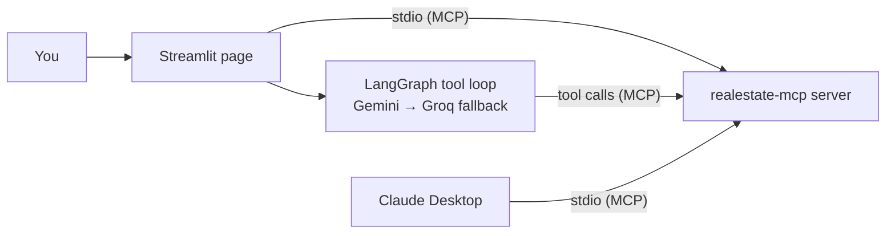

# Real-estate MCP server

An [MCP](https://modelcontextprotocol.io) server that gives any AI client the tools behind my first three
agents: agreement review, buyer helpdesk search, the RERA Act 2016 and land feasibility. Install it in
Claude Desktop, Cursor or VS Code and ask *"Review agreement B-204"*, or use the Streamlit client below,
which talks to the same server over the same protocol.

Week 4 of my public AI-agent portfolio · Week 1: [Clause Deviation Agent](https://github.com/Pallav6268/clause-deviation-agent) ·
Week 2: [Buyer Helpdesk Agent](https://github.com/Pallav6268/buyer-helpdesk-agent) ·
Week 3: [Land Feasibility Panel](https://github.com/Pallav6268/land-feasibility-panel)

> **Live client:** https://realestate-mcp.streamlit.app


## Use it in Claude Desktop

Needs [uv](https://docs.astral.sh/uv/) and git. No API key: the tools do not call a model.

Add this to `claude_desktop_config.json` (Claude Desktop → Settings → Developer → Edit Config) and restart:

```json
{
  "mcpServers": {
    "realestate": {
      "command": "uvx",
      "args": ["--from", "git+https://github.com/Pallav6268/realestate-mcp", "realestate-mcp"]
    }
  }
}
```

Or run it directly:

```bash
pip install git+https://github.com/Pallav6268/realestate-mcp
realestate-mcp                      # stdio, for MCP clients
realestate-mcp --transport http     # streamable HTTP at http://127.0.0.1:8000/mcp
```

## What the server offers

**Tools** (all read-only, with JSON schemas, input limits and structured output)

| Tool | From | Does |
|---|---|---|
| `list_agreements` | Week 1 | Sample agreements for sale and the developer's template |
| `scan_agreement` | Week 1 | Every clause against the template: matches, filled-in fields only, values differ (with both values), wording differs, missing |
| `review_clause` | Week 1 | Both texts of one clause plus an exact check of amounts, percentages, durations, areas and dates |
| `search_project_docs` | Week 2 | Keyword search over the project's FAQ, payment plan, possession, refund, maintenance and escalation documents; passages carry citable ids |
| `search_rera_act` · `read_rera_section` | Weeks 2–3 | The official RERA Act 2016 text, by keyword or section number |
| `list_parcels` · `assess_parcel` | Week 3 | Finance model, 10% sensitivity, comparables, site and title rubrics, RERA registration check, weighted score, Go / Conditional go / No-go with the legal veto. Takes what-if price, cost and one-off extra costs |

**Resources:** `agreement://{id}` (full text), `parcel://{id}` (raw dossier), `project://documents` (passage index).

**Prompts:** `review_agreement`, `feasibility_memo`, `answer_buyer`: ready-made workflows that tell the
model which tools to call and how to report.

**Instructions:** the server tells every client at connection what each tool is for and that the data is fictional.

### Design choices

- **The server does arithmetic, the model doesn't.** Every number comes from plain Python. The
  `feasibility_memo` prompt tells the model to call `assess_parcel` again for a what-if rather than work it out.
- **Honest limits in the output.** `scan_agreement` compares values and finds missing clauses exactly, and says
  "wording differs" where only a reader can judge the change. `assess_parcel` says it uses rubric scores only.
- **Errors are tool errors, not crashes.** Unknown IDs, negative prices or a 400-character query come back as
  MCP error results the model can read and correct.
- **No personal data.** Week 2's per-buyer booking lookup is left out: a server anyone can install should not
  expose buyer records without authentication.
- **Light install.** Two dependencies (`mcp`, `rank-bm25`). Week 2's embedding search is replaced with keyword
  search plus a small synonym map ("late" → "delay"), so the server starts in well under a second.

## The Streamlit client



- **Ask:** a chat assistant. For each question it starts the server as a subprocess, reads its instructions and
  tools over MCP, and runs a LangGraph loop that calls them. Every MCP call is shown with its arguments and result.
- **Tool explorer:** call any tool, read any resource and fetch any prompt directly, with no model in between.
- **Use it in Claude Desktop:** the config above.

The client has no tools of its own: it reads the tool list and instructions from the server on every connection, so new server tools appear without changing the client. Without an API
key it runs in demo mode, where a keyword rule picks one tool per question.

## Run locally

```bash
python -m venv .venv
.venv/bin/pip install -r requirements.txt pytest ruff     # Windows: .venv\Scripts\pip ...
.venv/bin/python -m pytest -q
.venv/bin/python -m streamlit run app.py
```

For the live assistant add `GEMINI_API_KEY` and/or `GROQ_API_KEY` to `.streamlit/secrets.toml`
(see `.streamlit/secrets.toml.example`).

## Tests

`pytest` runs the server through a real MCP client session: the tool list, schemas and read-only annotations;
every tool's structured result; the planted deviations in all three agreements; the Week 3 numbers
(parcel B at ₹5,500/sq ft with ₹1 crore extra: 13.7% margin, breakeven ₹4,745) and verdicts (Go, Conditional
go, No-go with the legal veto); error results for bad input; resources and prompts. The client tests start the
server as a real stdio subprocess and check parallel tool calls, provider fallback and error handling. No test
calls a paid API.

## Limits

- Agreements, project documents and parcels are fictional; the RERA Act text is the official one.
- Keyword search misses synonyms the small map doesn't cover. Rephrase with the documents' words if needed.
- Not legal or investment advice.

Built by [Pallav Kumar](https://www.linkedin.com/in/pallav-kumar-ai).
